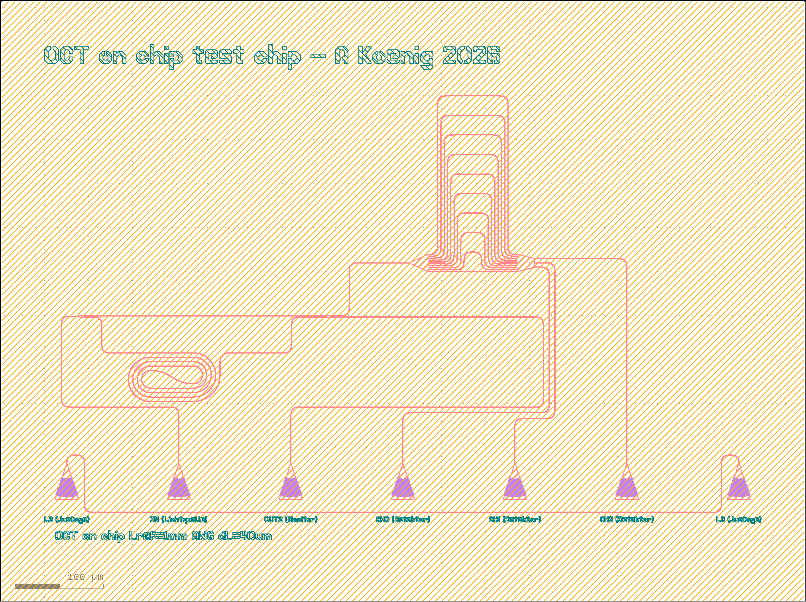

# OCT on a chip: PIC layout self-study

A learning project in photonic integrated circuit (PIC) layout with
[gdsfactory](https://github.com/gdsfactory/gdsfactory) and [KLayout](https://www.klayout.de):
from a first Mach-Zehnder interferometer to a complete test chip with a spiral delay line,
an arrayed waveguide grating (AWG) spectrometer, grating couplers and a design rule check.



## Motivation

While developing a low-cost home-care OCT device (optical coherence tomography of the retina),
I became interested in *OCT on a chip*: replacing the free-space interferometer and the grating
spectrometer of a spectral-domain OCT with waveguides, couplers and an on-chip spectrometer.
This project is my hands-on start in PIC layout.

| Spectral-domain OCT (free space / fibre) | This chip |
|---|---|
| Fibre coupler / beam splitter | 1×2 MMI splitter |
| Reference arm with mirror | Spiral delay line (path length and dispersion matching) |
| Interference at the coupler | 2×2 MMI combiner, two complementary outputs |
| Grating spectrometer + line camera | AWG spectrometer, one output channel per wavelength band |

## Test chip (`step5_full_chip.py`)

0.76 × 2.36 mm, from top to bottom:

1. **OCT-on-chip system**: spiral interferometer → AWG; ports `IN`, `OUT2` (monitor), `CH0–CH2`
2. **AWG test structure**: spectrometer alone
3. **Spiral interferometers** with 1 mm and 2 mm reference length (cut-back: propagation loss, group index)
4. **Reference MZIs** with ΔL = 50 µm and 200 µm

Every port has a labelled grating coupler on a 127 µm fibre-array pitch, and every block has a
loopback for fibre alignment and grating-coupler loss reference (de-embedding).

## Project structure

| File | Content |
|---|---|
| `pic_lib.py` | Component library: MZI, spiral delay, delay interferometer, AWG, OCT system, test structures with grating couplers and port labels, DRC function |
| `step1_mzi.py` | First MZI, ports, GDS export, FSR estimate |
| `step2_oct_testchip.py` | MZI with 2×2 output coupler, grating couplers, four ΔL variants |
| `step2b_oct_spiral_delay.py` | Interferometer with spiral delay line in the reference arm (1, 2, 5 mm) |
| `step3_drc.py` | Own DRC with the KLayout Python API; test cell with deliberate violations |
| `step4_awg_spectrometer.py` | AWG test structure and OCT-on-chip demonstrator, with DRC |
| `step4b_awg_debug.py` | Parameter sweep of the AWG (routing check + DRC) |
| `step5_full_chip.py` | Full test chip with frame, title and full-chip DRC |

## Results and lessons learned

**Interferometers** (FSR = λ² / (n_g · ΔL), λ = 1.55 µm, n_g ≈ 4.2):

| ΔL | 50 µm | 200 µm | 1 mm (spiral) | 2 mm (spiral) |
|---|---|---|---|---|
| FSR | 11.4 nm | 2.9 nm | 0.57 nm | 0.29 nm |

**AWG debugging** (`step4b_awg_debug.py`): with the gdsfactory AWG, arm *i* gets a detour of
height *i* · ΔL / 2, and two 90° bends with 10 µm radius need at least 20 µm. Routing therefore
fails for ΔL < 40 µm, independent of the star-coupler spacing. Star-coupler spacings below 100 µm
cause overlapping arms (spacing violations). Chosen: ΔL = 40 µm (FSR ≈ 14 nm), spacing 100 µm.
This shows a real trade-off between layout constraints (minimum bend radius) and optical design
(the AWG FSR must cover the source bandwidth).

**DRC** (simplified example rules, not foundry rules: min width 0.15 µm, min space 0.15 µm):

- Test cell with deliberate violations: 1 width and 1 spacing error, as intended.
- Grating couplers: acute corners of the taper (< 90°) are reported by the width check.
  As released library cells they are excluded via a documented waiver, instead of relaxing the rule.
- Full-chip DRC found a real error: with a 2×2 combiner, gdsfactory's `mzi` defaults (`o2`/`o3`,
  correct for 1×2) routed both arms into the same combiner input. Fixed with `o3`/`o4`.
- A missing connection (AWG channels not exported as ports) was **not** found by DRC. Checks like
  this are what LVS (layout versus schematic) is for.
- Final chip: DRC clean.

## How to run

```bash
python3.13 -m venv pic-env
source pic-env/bin/activate
pip install -r requirements.txt
python step5_full_chip.py      # or any step script
```

GDS files and DRC reports are written to `gds/`. With KLayout and the *klive* package open, layouts
appear automatically; DRC reports (`.lyrdb`) open via *Tools → Marker Browser*.
Tested with Python 3.13, gdsfactory 9.51 and KLayout 0.28 on macOS 12.

## Notes

This is a self-study project, developed with the help of an AI assistant (Claude). I set up the
environment, ran and debugged all scripts, investigated the DRC and routing errors in KLayout,
spotted the miswired combiner, decided on the chip content and worked through the underlying
physics and layout concepts.

The AWG is a layout demonstrator, not an optimised design: channel centre wavelengths, channel
width and crosstalk would need simulation (e.g. Ansys Lumerical) or measurement.

**Next steps:** a second AWG on `OUT2` for balanced detection, more AWG channels,
dispersion matching between reference and sample arm, connectivity (LVS-style) checks,
and a DRC deck in KLayout's DRC language.

## Author

Arian König · Optical engineer (B.Sc. Electrical Engineering, Optical Technologies) · Cologne, Germany
